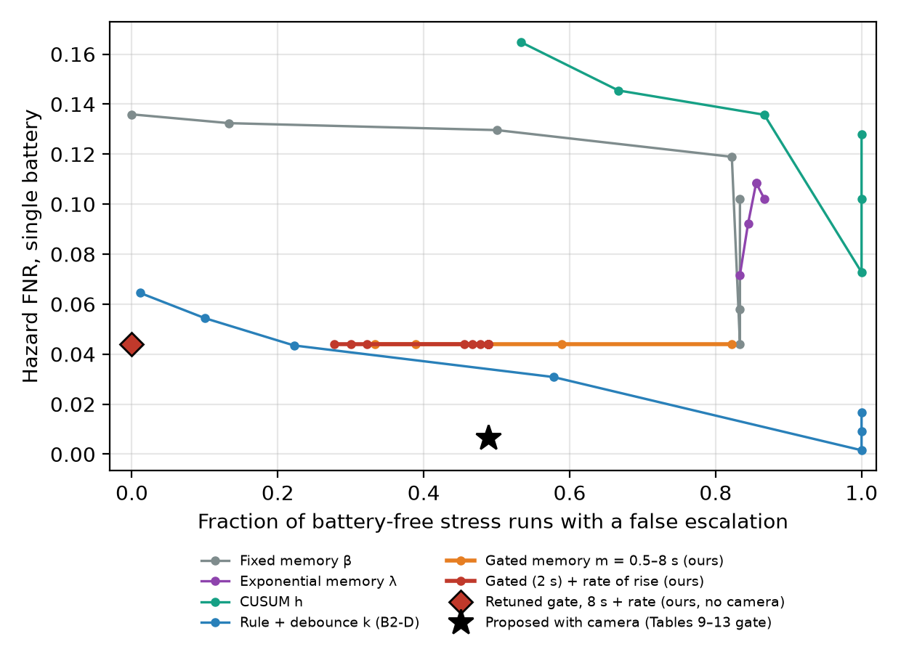

# E-Waste Safety: Hierarchical CNN with Adaptive Fuzzy Temporal Supervisory Risk Model

[](https://doi.org/10.5281/zenodo.23291424)

Code, trained models and results are archived on Zenodo: doi:10.5281/zenodo.23291424 (all versions; v1.0.0: doi:10.5281/zenodo.23291425). Public repository: https://github.com/Saivk25/ewaste-battery-safety

Early-warning and emergency-stop logic for **pre-shred lithium-ion battery fires** in e-waste recycling.
A two-stage CNN spots batteries on a conveyor, a fuzzy rule base reads temperature / gas / metal sensors,
an adaptive temporal filter smooths the risk, and a latching state machine slows or stops the shredder.

> **Scope:** all sensor data are **physics-based simulation**. There is no hardware pilot yet.
> The CNN results use real photographs (public datasets) on held-out test splits.

Authors: Sai Balaji R, Niketha R. Guide: Dr. Balamurugan B J, School of Advanced Sciences, VIT Chennai.

---

## How it works

```
Camera + sensors -> Coarse CNN (6 classes) -> [battery?] -> Fine CNN (3 Li-ion types)
                  -> Mamdani fuzzy inference (20 rules) -> S(t)
                  -> Adaptive temporal risk R(t) = beta(t)R(t-1) + (1-beta(t))S(t)
                  -> CNN fusion R_fused = R(t)(1 + alpha * P_battery)
                  -> Supervisory FSM: Normal / Warning / Critical / Emergency Stop (latched) / Sensor Fault
                  -> Shredder speed 100 / 60 / 10 / 0 / 50 %
```

| Symbol | Meaning | Value |
|---|---|---|
| `S(t)` | fuzzy risk score from temperature, H2, CO2, metal presence | 0 to 1 |
| `beta(t)` | **corroboration-gated adaptive memory**: `beta_fast` when `S(t) <= c`, or the temperature corroborates the rise (`T >= T_c`), or a gas-only rise has lasted `m` steps; otherwise `beta_slow` | beta_fast 0, beta_slow 0.99, c 0.5, T_c 40 C, m 20 steps (2 s) |
| `P_battery` | coarse-CNN probability that the object is a battery | 0 to 1 |
| Battery decision | "Battery" whenever `P_battery >= 0.1113` (chosen on validation data) | 0.1113 |
| `alpha` | CNN confidence amplification (can only raise risk) | 0.35 |
| FSM thresholds on `R_fused` | Warning / Critical / Emergency Stop | 0.30 / 0.55 / 0.75 |

The memory parameters were tuned on seeds 200-229 and evaluated on held-out seeds 100-129
(`src/gap_corroborated_memory.py`). The earlier exponential rule `beta = 0.85 * exp(-0.15 * |dS|)` is kept as
`AdaptiveRiskModel(mode="exp")` for comparison; on held-out seeds it was not better than a tuned fixed memory.

## Results (all reproducible from this repo)

**CNN (EfficientNet-B0, leak-checked splits)**

| Stage | Test accuracy | Test images | Battery detection |
|---|---|---|---|
| Coarse v3 (6 classes, Li-ion and damaged-battery photos added, threshold rule) | 91.18 % | 692 | 259 / 259 intact batteries (95 Garbage-12, 164 RecyBat24 Li-ion) + 5 / 7 damaged; 21 / 426 false alarms |
| Fine (3 Li-ion subtypes) | 99.64 % | 2,208 (164 source photos, all correct by majority vote) | errors only between pouch and LiPo |

The first coarse model (87.72 %, kept in `checkpoints/legacy_v1/`) recognised only 4.4 % of the RecyBat24 Li-ion photos the pipeline
feeds it, so it was retrained with those photos (`src/build_coarse_v2.py`). Earlier, a coarse-dataset leak (750 byte-identical files
across splits) had also been found and fixed. Measured single-image latency of the coarse model (idle machine, `results/pub/speed.json`): 14 ms on an RTX 5060 laptop GPU,
28-32 ms on its CPU; YOLOv8n 13 ms GPU / 44 ms CPU; fuzzy + memory + FSM 1.2 ms per 0.1 s step.

**Simulation, held-out seeds 100-129** (every tunable setting chosen on seeds 200-229; Hazard FNR = share of hazardous
time steps with no alert; n = 28 seeds that reached a hazard). Full tables: `results/pub/summary.txt`, `fixes_summary.txt`, `fixes2_summary.txt`.

| System | Single battery | Temperature 60 s late | False Critical / E-stop, hard gas bursts (of 30) | Warm item + bursts (of 30) |
|---|---|---|---|---|
| B0 camera-only stop (real CNN) | 0.1786 | 0.1786 | 0 / 0 | 0 / 0 |
| B2 rule-based | 0.0016 | 0.0481 | 30 / 30 | 30 / 30 |
| B2-D rule + 3 s debounce (tuned) | 0.0435 | 0.1963 | 2 / 2 | 2 / 2 |
| B3 fixed-memory fuzzy | 0.1279 | 0.3795 | 30 / 0 | 30 / 0 |
| CUSUM on the fuzzy score (tuned) | 0.1455 | 0.4109 | 0 / 0 | 30 / 30 |
| B4 logistic regression (trained on tuning seeds) | 0.0000 | 0.2536 | 0 / 0 | 30 / 30 |
| **Proposed** (gate of the paper tables) | **0.0064** | **0.0557** | **0 / 0** | 30 / 0 |
| **Proposed, retuned gate (recommended)** | **0.0064** | **0.0557** | **0 / 0** | **0 / 0** |

- Proposed vs B2-D: -0.037 [-0.055, -0.024], Holm p = 0.001; vs B3, CUSUM, B1: p < 0.0001. Vs plain B2: not significant (Holm p = 0.22) -- B2's weakness is false stops.
- Retuned gate = 8 s gas persistence + temperature corroboration only while the temperature is still rising (10 s slope >= 0.2 C/s); cost: about 1 s later stops for cells that arrive already hot (4.2 s vs 3.1 s). Selected on tuning seeds; it missed the pre-set stop-time tolerance by 0.1 s, which the paper states.
- Without the camera, the original gate was **not** better than a tuned debounce; the retuned gate is (0 false escalations at the same miss rate). Paper Fig. 4.
- Generalisation: a literature-calibrated thermal model (all systems stop before runaway; ours 174 s early) and 7 measured cell temperature curves (Kwak et al. 2026; 21/21 runs stopped before runaway, about 20 min early; gas from the model).
- Sensor faults (`src/sensor_health.py`, `results/pub/faults_summary.txt`): frozen IR, dead gas sensor, camera loss, missing readings and gas drift are detected; a fault can no longer keep the shredder at 50 % during a real hazard (bug fixed).
- CNN repeats on data_v3: EfficientNet-B0 never missed an intact test battery in 3 seeds (4-5 / 7 damaged found); MobileNetV2 / EfficientNet-B3 more accurate but missed 1-2 intact batteries (`results/pub/cnn_repeat_eval.csv`). Cluttered frames: YOLOv8n detector (`results/pub/detector_summary.json`).
- Moving belt (`src/conveyor_sim.py`, `results/conveyor/summary.txt`, paper Table 18): camera, sensor hood, diverter and shredder on a 0.25 m/s belt with diluted gas and sensor lag. Suspect items are diverted to a monitored bin; the belt stops only for a confirmed hazard. Failing cells that entered the shredder while self-heating: camera-only 210/330, plain rule 60/330, **ours 0/330**. A battery hidden in a device at 60 C: rule and camera-only shred 30/30, ours diverts 30/30 (bin alarm 7.0 s before runaway). Divert threshold = the validated detection threshold P_battery >= 0.1113: intact visible batteries shredded 0/30; benign items 1/30 falsely diverted (to the bin, no belt stop), 0 false stops.
- Reviewer checks (`docs/GAP_ANALYSIS.md`, top section): Ni-MH 21/21 and Ni-Cd 24/24 photos from an outside dataset detected as batteries (`results/external/`); camera alone diverts 348/420 real battery-containing WEEE devices (XBAT+); camera retrained with 35 vetted photos of swollen / corroded / leaking batteries (model v3: damaged test batteries 5/7, was 3/7; `results/gaps/coarse_v3_eval.txt`); +/-20 % sensitivity of every hand-set constant (`results/pub/sensitivity_summary.txt`: five constants are sensitive and need commissioning); gas model rescaled, delayed or removed (`gas_sensitivity_summary.txt`); main vs literature-calibrated thermal model (`thermal_compare_summary.txt`: the main model is the harder case); detector on a real recycling-plant conveyor (ZeroWaste): false battery boxes 17.6 % -> 0.7 % of held-out frames after fine-tuning on other videos (`detector_realbelt_summary.json`, weights in `checkpoints/detector/`).
- Business case, placement and failure-mode review: `docs/SHARK_TANK_REVIEW.md`.



### Things to know before relying on the numbers
- **Simulation only.** No hardware or real fire test. The main thermal model's onsets sit 40-90 C below published values; a second, literature-calibrated model and measured cell curves are used as checks.
- **Known weaknesses:** any object at 90 C or hotter causes a stop (by design); a continuously full belt cannot auto-zero gas-sensor drift; a gas-only rise never corroborated by temperature waits up to 8 s with the retuned gate.
- Camera images are public product-style photos; the clutter test uses composites. Only 3 Li-ion types in the fine stage (Ni-MH / Ni-Cd checked on 45 outside photos only). Fuzzy rules, FSM thresholds and alpha are hand-set.
- `results/results_EfficientNetB3_*.json` / `results_MobileNetV2_*.json` are legacy pre-leak-fix runs; the current comparison is `results/pub/cnn_repeat_eval.csv`.

## Quick start

```bash
pip install -r requirements.txt          # install torch/torchvision for your CUDA version separately
pytest                                   # 92 tests
streamlit run dashboard.py               # live dashboard (run from the repo root)
python src/main_pipeline.py              # full pipeline
bash scripts/reproduce_all.sh            # every result in results/pub/ in order (several hours, GPU recommended)
python src/business_case.py              # cost / placement / payback calculator self-check
python src/conveyor_sim.py               # moving-belt test (about 20 min on 12 processes)
```

Windows: `run_dashboard.bat` (set `PORT` to change the port). The dashboard and scripts expect to be run from the repo root
(`checkpoints/` and `data/` are resolved relative to the working directory).

The trained checkpoints are in `checkpoints/`. The image datasets are **not** included (see `data/dataset_manifest.json`; `src/build_coarse_v2.py` builds `data_v2/` from them):
TrashNet, Garbage-12 (Kaggle) and RecyBat24 (Zenodo DOI 10.5281/zenodo.13126689).

## Dashboard tabs
Conveyor Line (animated belt: camera-only vs plain rule vs ours) | Live Monitor | Manual Control (all 20 fuzzy rules) | Baseline Race (8 systems side by side) | Break It (Emergency Stop latch) |
Upload & Classify (real CNN, Grad-CAM, YOLO boxes) | Custom Sequence | Results (held-out tables, statistics, trade-off) |
Real Measured Cell (replay a measured runaway curve) | Business Case (cost, placement, payback).
Verified headless: `pytest tests/test_dashboard_smoke.py`, `python tests/verify_dashboard_interactive.py`.

## Repository layout
```
src/        pipeline: sensor_simulation, fuzzy_inference, adaptive_risk, supervisory_control,
            baseline_comparison, training / evaluation, sweeps
tests/      pytest suite (92 tests) + dashboard checks
dashboard.py
checkpoints/  trained EfficientNet-B0 (coarse v2 + fine); legacy_v1/ = first coarse model
results/    CSVs, confusion matrices, ROC/PR, Grad-CAM, sweep outputs
docs/       data sources, review-gap analysis, figures
```

## Paper
A paper describing this work is in preparation; the citation will be added here.

## Data and model credits
TrashNet (Yang and Thung, 2016), Garbage Classification (Mostafa, 2021), RecyBat24 (Acaro Chacon et al., Sci. Data 2025),
EfficientNet (Tan and Le, 2019). Thermal-runaway background: Feng et al. 2018; Golubkov et al. 2014; Finegan et al. 2024; Gardner et al. 2025.
Measured cell curves: Kwak et al., Sci. Data 13, 1084 (2026), OSF doi:10.17605/OSF.IO/C2HNQ (not redistributed). YOLOv8 (Ultralytics).

## Licence
Code: MIT (see `LICENSE`). Datasets and anything trained on them (checkpoints) remain under their own licences:
TrashNet, Garbage Classification (Kaggle), RecyBat24 (see each source); the measured cell curves (Kwak et al. 2026) are not redistributed.
